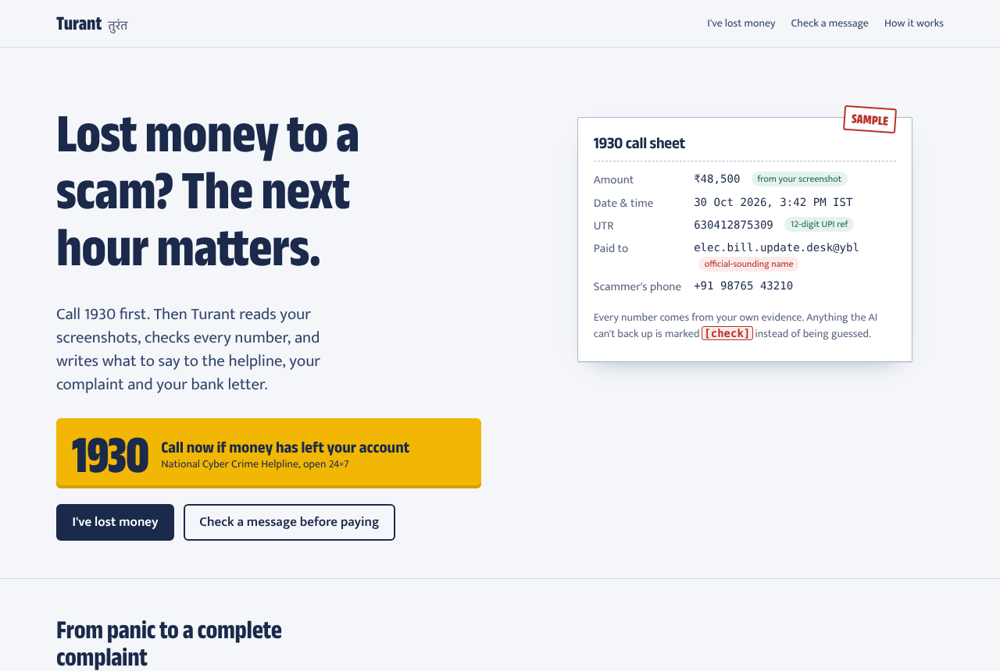
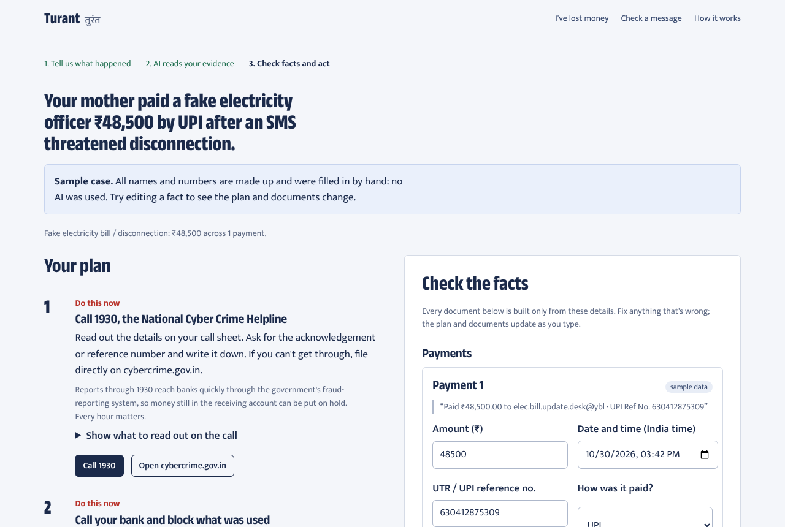
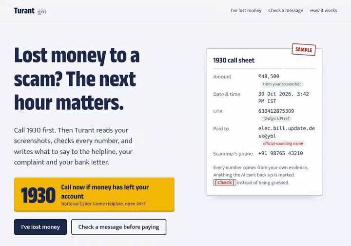
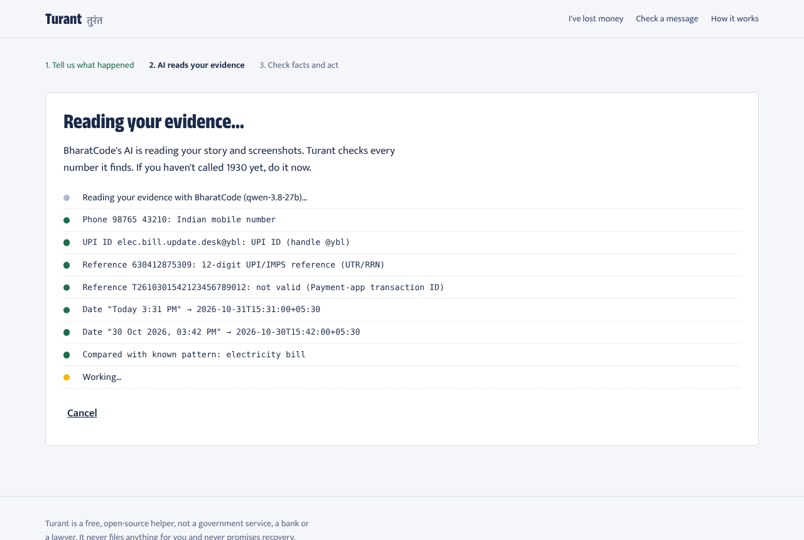
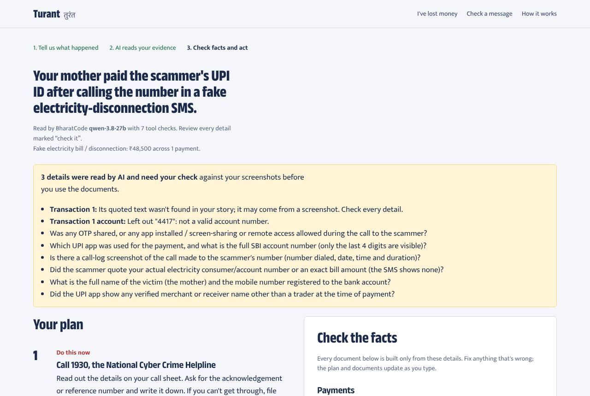
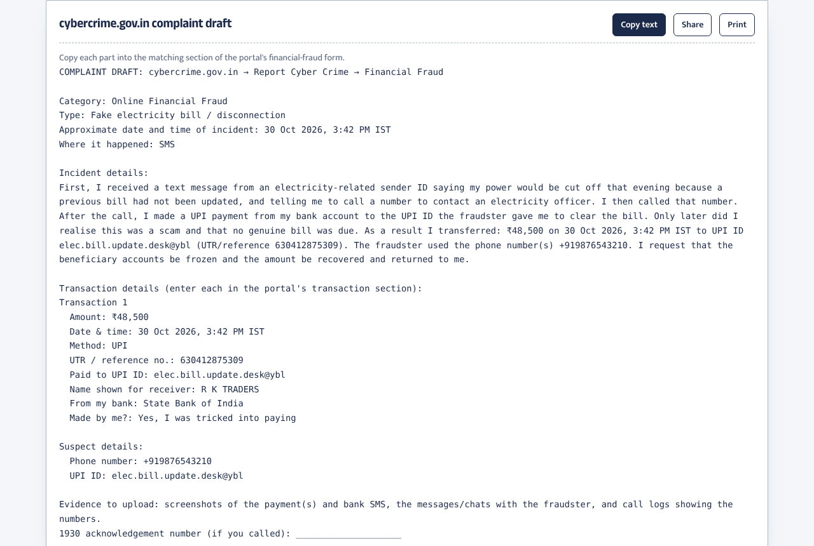
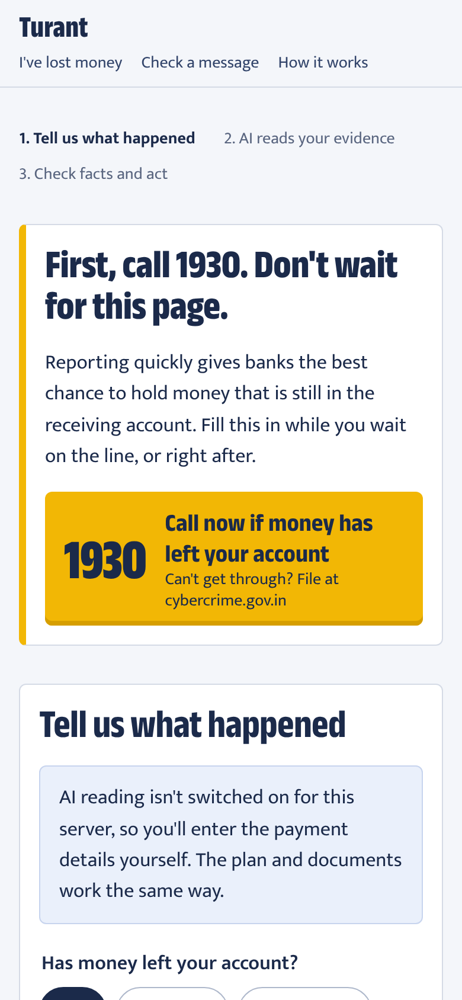
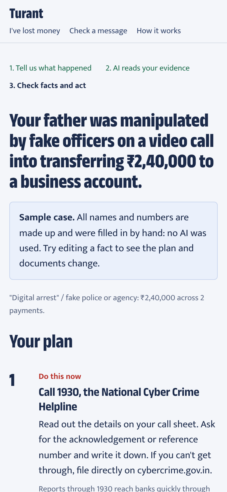
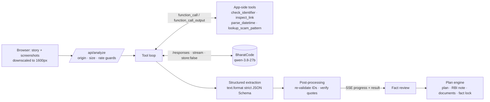

# Turant (तुरंत)

**Lost money to a scam? The next hour matters.**
Turant tells a person in India what to do, in the right order, right after a scam. It also writes the text
they need: what to read out to the 1930 helpline, a cybercrime.gov.in complaint, and a letter to their bank.
Every number in that text comes from their own evidence.

Free and open source. Built for the [BharatCode Build League 2026](https://bharatcode.ai/hackathon). AI reading
is powered by [BharatCode](https://bharatcode.ai/build) (`qwen-3.8-27b`).



> Turant is not a government service, a bank or a lawyer. It never files anything for you and never promises
> recovery. In an emergency, call **1930** first.

## The problem

Indians reported about **24 lakh financial cyber-fraud complaints and roughly ₹19,800–22,500 crore in losses in 2025**
(I4C/NCRP figures as reported; sources in [`research/competitor-analysis.md`](research/competitor-analysis.md)).
Reporting fast matters: complaints through 1930 let banks put a hold on money that is still in the receiving
account.

In that first hour a victim, often an older parent with a student child helping by phone, has to:

- find the UTR, the receiver's UPI ID, the exact time and the amount, buried in screenshots;
- know the order: helpline, bank block, written complaint, bank letter;
- avoid wrong advice. The most common mistake online is "RBI guarantees a refund in 3 days". RBI's 2017 rule
  covers *unauthorised* transactions. Payments a person was tricked into making are usually not covered.

Truecaller's Scam Checker, ScamDekho and others help **before** you pay. Nothing we found helps **after**.

## What Turant does

| | |
|---|---|
| **Call 1930 first** | Shown before any form, as a tap-to-call button. The AI never stands between a victim and the helpline. |
| **Reads your evidence** | Story in any language plus up to 4 screenshots (UPI receipts, bank SMS, chats), read by BharatCode's Qwen 3.8 27B with image input. |
| **Checks every number** | UTRs, UPI IDs, IFSCs, phone numbers, accounts and links are validated by deterministic code. Each fact shows where it came from, and screenshot-read facts are marked "check it". |
| **Plan in the right order** | Built by tested rules, not the model. Lock-down steps appear only when the evidence shows a shared OTP or an installed remote-access app. |
| **Honest refund note** | Applies RBI's 2017 liability circular only where it applies, with working-day counting for the 3- and 7-day limits. |
| **Ready-to-use text** | A 1930 call sheet (English + Hindi labels), a cybercrime.gov.in complaint draft and a bank letter, with copy, share and print. |
| **Fact lock** | Any number in AI-written text that isn't a confirmed fact is replaced with **[check]**. |
| **Check before you pay** | Paste a message or add a screenshot. Fixed rules set a minimum verdict that the AI can raise but never lower. |
| **Works without AI** | Sample cases, manual entry and rule-based checks work with no API key. |



![Fact lock: a number that isn't a confirmed fact becomes [check] in the complaint](docs/media/fact-lock.png)

### Demo



*The demo uses a hand-written sample case (no AI call). Screenshots of the AI path are below.*

### A real run on BharatCode

Captured on 31 Oct 2026 with `qwen-3.8-27b` reading the two fictional sample screenshots in
[`public/samples/`](public/samples). This is real model output: nothing is scripted.





<p>


</p>

## How BharatCode powers it



1. **Reading with tools.** The model receives the story and screenshots as `input_image` parts and calls
   Turant's tools to validate each identifier and normalise each date. Tool results go back as
   `function_call_output` items. When a validator rejects a misread UTR, the model looks again.
2. **Structured extraction.** The whole transcript is replayed (the API is stateless) with a strict JSON
   Schema in `text.format`. Every transaction must quote the text it came from.
3. **Code takes over.** Identifiers are re-validated, story quotes are verified against the story, and
   screenshot facts are labelled for human checking. The plan and documents are computed deterministically.

The person watches it happen: each tool call appears live on screen ("Reference 630412875309: 12-digit UPI/IMPS
reference").

Integration details ([`src/lib/bharatcode/`](src/lib/bharatcode)):

- `store: false` on every call (enforced by the type), streaming always on; no `previous_response_id`, no hosted tools.
- Queue keepalive SSE comments become a "waiting in queue" status, never text.
- `503` → up to 3 retries (2 s, 4 s, 8 s + jitter, honouring `Retry-After`); `429` → one retry; network → one retry; `400/401/403` → no retry.
- `response.incomplete` → partial text kept, **no tool call from it is executed**. For structured output the budget
  is doubled once (never retried with the same budget).
- `response.failed` and stream breaks → typed errors carrying BharatCode's `x-request-id`, shown to the person as a support reference.
- `text.format` rejected with 400 → one fallback to plain JSON. Invalid JSON → one repair round, then the manual form opens with inputs intact.

See [`docs/ARCHITECTURE.md`](docs/ARCHITECTURE.md) for the full design.

## Run it

Requires Node.js 20.9+.

```bash
git clone https://github.com/Sahvendra7/BharatCode.git turant
cd turant
npm install
cp .env.example .env.local
```

Add your key to `.env.local` (free for verified students at [bharatcode.ai/account](https://bharatcode.ai/account)), then:

```bash
npm run dev
```

Open http://localhost:3000. Without a key, sample cases, manual entry and rule-based checks still work.

### Environment variables

| Variable | Required | Default | Purpose |
|---|---|---|---|
| `BHARATCODE_API_KEY` | for AI features | none | Server-side only. Never exposed to the browser. |
| `BHARATCODE_MODEL` | no | `qwen-3.8-27b` | `deepseek-v4.1-flash` works with a Pro key |
| `BHARATCODE_BASE_URL` | no | `https://bharatcode.ai/api/model/v1` | Must be https (localhost allowed for tests) |
| `BHARATCODE_TIMEOUT_MS` | no | `150000` | Per call, including queue time |
| `TURANT_RATE_LIMIT_PER_10_MIN` | no | `8` | AI requests per client IP per 10 minutes |

### Deploy

Any Node host that runs Next.js (Vercel, Render, a VM). Set `BHARATCODE_API_KEY` as a secret. No database or storage
is needed. The rate limiter is in-memory, so run a single instance or swap in a shared store.

## API

| Endpoint | Body | Response |
|---|---|---|
| `GET /api/health` | none | `{ ok, version, model: { configured, id } }` |
| `POST /api/analyze` | `{ story, images: [{ dataUrl }], paid: "yes"\|"no"\|"unknown", discoveredAt }` | SSE: `progress` events, then `result { case, warnings, model, toolCalls }` or `error { kind, message, requestId }` |
| `POST /api/check` | `{ text, images }` | SSE: `progress`, then `result` (verdict, rule and AI signals, identifiers) |

Limits: story/text ≤ 4,000 chars; ≤ 4 images (PNG/JPEG/WebP, ≤ 3 MB each, magic bytes checked); body ≤ 14 MB; same-origin only.

## Testing and evaluation

```bash
npm test              # 136 unit, integration and API tests (Vitest)
npm run test:e2e      # 36 Playwright tests, desktop + mobile, with axe accessibility checks
npm run eval:rules    # offline benchmark of the rule floor
npm run verify:live   # live checks against BharatCode (needs a key)
npm run eval          # live extraction benchmark on 7 gold cases (needs a key)
```

What the tests cover: validators, IST date parsing and bank working days, every plan branch, the RBI
classifier, fact lock, documents, the BharatCode client against fixtures in the documented wire format (keepalive,
503/429 retries, `response.failed`, incomplete responses, abort), the tool loop (never runs incomplete calls,
validates arguments), structured output (fallback, repair, budget), route guards, and the full UI.

**Measured results, stated honestly:**

| Measure | Result | Caveat |
|---|---|---|
| Unit/integration/API tests | 136/136 passing | |
| E2E (desktop + mobile) | 36/36 passing, no serious/critical axe violations | AI path E2E uses a local stub of BharatCode's protocol |
| Rule floor on authored set | 20/20 scam messages flagged, 0/10 ordinary messages flagged | Messages were written by the developers who wrote the rules: a regression baseline, **not** real-world accuracy |
| Live API checks (`npm run verify:live`) | 5/5 pass: models, streaming, `text.format`, tool round-trip, image input | Run 30 Oct 2026 |
| Extraction on 7 gold cases (`npm run eval`, `qwen-3.8-27b`) | Amounts 9/9, UTRs 5/5, payees 7/7, scammer IDs 9/9, money-lost 7/7, transaction count 6/7, scam type 6/7 | Small, developer-written fictional set (English, Hinglish, Hindi, screenshots): an early signal, not a benchmark |
| Invented numbers in AI-written narrative | 0 before the fact lock, 0 after | Same 7 cases |
| Time per analysis | median 82 s on the benchmark; 74–226 s in UI runs | Includes queueing on BharatCode's shared capacity |

## Project structure

```
src/
  app/                 pages and API routes (Next.js App Router)
  components/          UI: flows, fact editor, document slips, trace
  data/                official channels, scam patterns, sample cases (fictional)
  lib/
    bharatcode/        Responses API client, SSE, tool loop, structured output, errors
    pipeline/          analyse-incident and check-message pipelines, prompts, post-processing
    engine/            plan, RBI entitlement, documents, fact lock, rule floors (pure)
    validators/        UTR, UPI ID, IFSC, phone, account, email, URL inspection
    tools/             tools exposed to the model
    server/            guards, rate limiting, SSE writer, handlers
e2e/                   Playwright suite and the BharatCode protocol stub
eval/                  gold cases and benchmarks
research/              hackathon, competitor and opportunity research
docs/                  PRD, architecture, plans, launch kit, submission checklist
```

## Limitations

- Extraction accuracy was measured on only 7 fictional cases. In real runs the model sometimes puts a value in the wrong field (a receiver name as an account number); validators drop those and say so, but always check facts against your screenshots.
- An analysis takes 1–4 minutes depending on BharatCode's queue. That's why the 1930 call comes first and the page shows live progress.
- Bank working days ignore public holidays (stated in the app).
- Official procedures change. The secondary-source detail about completing a 1930 report within ~24 hours is
  worded as guidance, and RBI ombudsman time limits are deferred to the portal.
- English UI with Hindi labels on the call sheet; full Indian-language UI is future work.
- Does not detect forged payment screenshots or file complaints for you.

## Contributing

See [CONTRIBUTING.md](CONTRIBUTING.md). Scam patterns in more Indian languages are especially welcome.
Security issues: [SECURITY.md](SECURITY.md).

## License

[MIT](LICENSE). Official channels referenced: [cybercrime.gov.in](https://cybercrime.gov.in) / 1930 (I4C, MHA),
[Sanchar Saathi](https://sancharsaathi.gov.in) (DoT), [RBI](https://www.rbi.org.in), [RBI CMS](https://cms.rbi.org.in).
