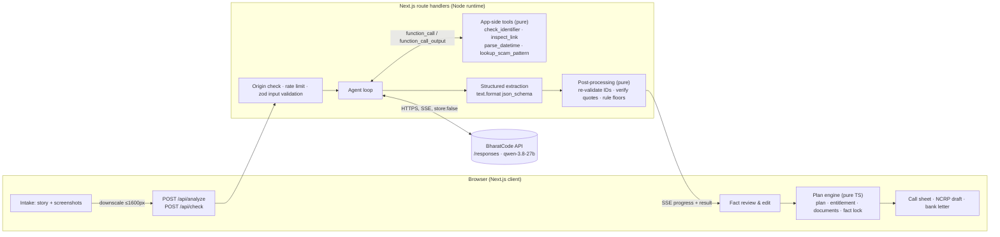

# Turant: architecture

## 1. Principle

> **The model reads. Code decides.**

BharatCode's Qwen 3.8 27B does what only a model can do: read screenshots and messy multilingual stories, and
pull out structured facts with quotes. Everything that has consequences (which steps to take, in what order, what
the person may be entitled to, and which numbers go into a complaint) is computed by deterministic, unit-tested
TypeScript from facts **the person has confirmed**.

## 2. System diagram



ASCII fallback:

```
Browser ── story + images ──▶ /api/analyze ──▶ guard ──▶ agent loop ◀──▶ BharatCode /responses (stream, store:false)
                                                   │  ▲
                                                   ▼  │ function_call_output
                                              app-side tools (pure, no network)
                                                   │
                                              structured extraction (text.format) ──▶ post-processing
Browser ◀── SSE: queued / tool / extracted / done ──┘
Browser: fact review ──▶ plan engine (pure) ──▶ documents (fact-locked)
```

## 3. Components

| Path | Responsibility |
|---|---|
| `src/lib/bharatcode/` | **Model integration layer.** Config, typed Responses API client, SSE parser, error taxonomy, retry policy, agent (tool) loop, structured-output helper |
| `src/lib/tools/` | App-side tools exposed to the model, each with a zod argument schema and a JSON Schema for the API |
| `src/lib/validators/` | Pure validators: UTR/RRN, UPI ID, IFSC, phone, account number, email, URL/domain analysis |
| `src/lib/domain/` | Zod schemas for `Incident`, `MessageCheck`, facts with sources; normalisation |
| `src/lib/engine/` | Pure plan engine: steps, working-day calculator, RBI entitlement classifier, document generators, fact lock, scam rule floors |
| `src/lib/server/` | Request guards: origin check, token-bucket rate limiter, body limits, SSE response writer, logger without content |
| `src/app/api/*` | Route handlers: `analyze`, `check`, `health` |
| `src/app/*` | Pages: landing, `/help` (lost money), `/check`, `/how-it-works`, `/privacy` |
| `src/data/` | Curated, sourced reference data: scam patterns, official channels, sample cases |
| `eval/` | Gold cases and runners for model extraction and rule floors |

## 4. Model interaction strategy

### 4.1 Endpoint and model
- **Responses API** (`POST /responses`), always `store: false`, always `stream: true`.
- Model from `BHARATCODE_MODEL` (default `qwen-3.8-27b`, the model students and judges can run). `deepseek-v4.1-flash` works where the key is Pro.
- No `previous_response_id`, no hosted tools, no background mode, no file input (all rejected with 400 per docs).

### 4.2 Phase A: tool-using reading
Input: system `instructions` + one user message containing `input_text` (story + context such as "today is …
IST") and up to 4 `input_image` parts (data URLs). Tools (JSON Schema, `strict: true`):

| Tool | Purpose | Why a tool, not a prompt |
|---|---|---|
| `check_identifier(kind, value)` | Validate/normalise a UTR, UPI ID, IFSC, phone, account, email | Models can't reliably validate formats; results flow back so the model corrects misreads |
| `inspect_link(url)` | Host, registrable domain, official-domain match, look-alike/punycode/shortener/IP/APK flags | Deterministic phishing signals |
| `parse_datetime(text)` | Convert "30/10/26 3:42 PM" etc. to ISO IST relative to the request time | Avoids timezone/format hallucination |
| `lookup_scam_pattern(pattern)` | Return the curated description and typical signs of a pattern | Grounds the classification in curated text |

Loop rules:
- Max 5 rounds, max 16 tool calls total; then proceed to Phase B with what exists.
- A function call is executed **only** if the response `status` is `completed` and the item's arguments parse and validate. If the response is `incomplete`, partial text is kept and **no** tool call from it is executed.
- Each round replays: original input + every previous output item + `function_call_output` items (`call_id`, string `output`), and resends tool definitions (the API is stateless).
- Tool errors are returned to the model as `{"error": "..."}` strings, never thrown to the user.

### 4.3 Phase B: structured extraction
Same replayed conversation + a final instruction, with `text.format = {type: "json_schema", name, strict: true, schema}`
generated from the zod schema and checked by a unit test for strict-mode rules (all properties required,
`additionalProperties: false`, nullable via `anyOf`). If the API rejects `text.format` (400), retry once **without** it,
asking for JSON only, and parse the first JSON object. The result is validated with zod; on failure, one repair
round with the zod issues; if still invalid, return `invalid_output` and the UI opens manual entry with any partial facts.

### 4.4 Budgets
`max_output_tokens`: Phase A 4,000; Phase B 6,000. `reasoning: {effort: "low"}` for Phase A tool decisions. On
`incomplete` with reason `max_output_tokens` in Phase B, retry **once** with a doubled budget (never the same budget),
capped at 16,000; then fail gracefully.

### 4.5 Post-processing (deterministic, server)
1. Re-run every identifier through validators (the model's own claims are ignored).
2. For facts sourced from the story: verify the quote occurs in the story (whitespace/case-normalised). Mismatch → source downgraded to `unverified`.
3. Facts sourced from an image are tagged `ai_read_image`, and the UI asks the person to check them.
4. Rule floors for "check" mode (see §6).

## 5. Error-handling strategy

| Condition | Detection | Behaviour |
|---|---|---|
| No API key | config | `/api/health` reports `model.configured=false`; UI hides "Analyse" and offers manual entry; API returns 503 `model_not_configured` |
| 401/403 | HTTP status | No retry; `auth` error; message to operator in logs, generic to user |
| 400 | HTTP status | No retry; `bad_request` with BharatCode's message; structured-output fallback as §4.3 |
| 429 | HTTP status | Respect `Retry-After` once, then `rate_limited` |
| 503 | HTTP status | Retry ×3 with backoff 2 s, 4 s, 8 s (+ jitter, honour `Retry-After`); UI shows "BharatCode is busy, retrying" |
| Network error / timeout | fetch rejection / AbortSignal | Retry once (idempotent call); then `network` / `timeout` |
| SSE keepalive comment | line starts with `:` | Not output; emits `queued` progress |
| `response.failed` | SSE event | `failed` error with the event's message |
| `response.incomplete` | SSE event / status | Keep partial text; never execute tool calls from it; budget rule §4.4 |
| Invalid tool arguments | zod | Return error string to model; count against budget |
| Invalid final JSON | zod | One repair round; then `invalid_output` + manual entry |
| Client disconnect | request `signal` | Abort the upstream fetch |

Every error carries `kind`, `retryable`, HTTP status if any, and BharatCode's `x-request-id` (shown to the user as a
support reference; it is not secret).

## 6. Plan engine (deterministic)

Inputs: confirmed `Incident` + `now` + `discoveredAt`. Outputs: ordered steps, entitlement note, documents.

- **Steps** (each with urgency `now` / `today` / `this_week` / `later` and a reason):
  1. Call 1930 (if any money left the account) and note the acknowledgement number.
  2. Call the bank's official number to block the instrument(s) involved and report the transactions.
  3. If OTP/PIN/card/net-banking credentials were shared → change PINs/passwords from another device; block cards.
  4. If a remote-access app or unknown APK was installed → disconnect data, uninstall, then change passwords from another device.
  5. Complete the complaint on cybercrime.gov.in with the acknowledgement number.
  6. Give the bank a written dispute (letter), keep the receipt/reference.
  7. Preserve evidence (no deleting chats; screenshots with visible dates).
  8. Report the scammer's numbers on Chakshu (sancharsaathi.gov.in) when no money was lost; when money was lost, the 1930/NCRP complaint is the channel.
  9. If the bank doesn't resolve within 30 days → RBI CMS (cms.rbi.org.in, 14448).
- **Entitlement classifier** (RBI DBR.No.Leg.BC.78/09.07.005/2017-18):
  - Payment made by the victim under deception (authorised) → "The RBI zero-liability rule is for unauthorised transactions. A payment you made yourself, even if tricked, is usually not covered. Recovery depends on quickly holding funds through 1930."
  - Unauthorised (the victim didn't make it) and no credentials shared → working days from `discoveredAt` to `now`, excluding Sundays and 2nd/4th Saturdays (public holidays can't be known: stated): ≤3 → zero liability band; 4–7 → capped band (₹5,000/₹10,000/₹25,000 by account type, or the transaction value if lower); >7 → bank's board-approved policy. Reversal "within 10 working days of notification" quoted.
  - Unauthorised but credentials shared → "The circular says the customer bears the loss until reporting when credentials were shared; report now to stop further loss."
- **Fact lock:** collect canonical numbers from confirmed facts (amounts in several renderings, UTRs, phones, account numbers, dates). Scan generated narrative for digit runs; any run not in the set is replaced by `[check]` and reported.

## 7. Data model (abridged)

```ts
Fact<T> = { value: T; source: { kind: "story" | "image" | "user"; index?: number; quote?: string };
            verification: "verified_in_story" | "ai_read_image" | "user_entered" | "unverified" }
Transaction = { amountInr, occurredAt, reference /* UTR/RRN */, method, payerBank, payeeUpiId,
                payeeAccount, payeeIfsc, payeeName, madeByVictim: "yes" | "no" | "unknown" }  // each a Fact
Incident = { paid: "yes" | "no" | "unsure", pattern, channel, summary, transactions[], suspect { phones[], upiIds[],
             urls[], accounts[], emails[] }, compromise { otpOrPinShared, remoteAppInstalled, remoteAppName,
             cardDetailsShared, netBankingShared, unknownApkInstalled }, missingInfo[], narrative }
```

## 8. Database design

None, by decision. A case contains sensitive financial data; storing it creates liability without user benefit in
v1. The browser keeps the active case in `sessionStorage` (cleared on tab close or "Clear this case").

## 9. Backend API

| Method & path | Request | Response |
|---|---|---|
| `GET /api/health` | — | `{ ok, model: { configured, id }, version }` (never the key) |
| `POST /api/analyze` | `{ story, images: [{ dataUrl }], paid, discoveredAt?, language }` (≤ 12 MB) | `text/event-stream`: `status`, `queued`, `tool`, `retry`, `result { incident, warnings }`, `error { kind, message, requestId }` |
| `POST /api/check` | `{ text, images }` | SSE as above with `result { check }`; if no key: rules-only result with `aiUsed:false` |

## 10. Security

- Key only in server env (`BHARATCODE_API_KEY`); never in `NEXT_PUBLIC_*`; a test fails if the client bundle contains `BHARATCODE_API_KEY` or `bc_live_`.
- `Origin`/`Host` same-origin check on POST; JSON only; body limit; zod validation; image MIME sniffed from the data-URL header and magic bytes.
- Token-bucket rate limit per IP (analyses are expensive for a shared pool). In-memory: adequate for a single instance; documented limitation for multi-instance deploys.
- Security headers: CSP (`default-src 'self'`; images `self data: blob:`), `X-Content-Type-Options`, `Referrer-Policy`, `X-Frame-Options: DENY`, `Permissions-Policy` (camera/mic/geo off).
- Prompt injection: screenshots may contain attacker text. Tools are read-only and side-effect free; the model cannot send messages, fetch URLs or change the plan. The instructions tell the model to treat all content as data.
- Logs: request id, route, duration, outcome kind. Never story text, images, or extracted facts.

## 11. Testing strategy

| Layer | Tooling | Examples |
|---|---|---|
| Unit | Vitest | validators, URL analysis, working days, entitlement, plan branches, fact lock, rule floors, SSE parser, JSON-schema strictness |
| Integration | Vitest + fake `fetch` speaking the documented SSE/JSON formats | 503 retry, keepalive → queued, `response.failed`, incomplete tool call not executed, invalid tool args, structured fallback & repair, abort |
| API | Vitest calling route handlers directly | validation errors, origin rejection, rate limit, no-key 503, rules-only check |
| Frontend/E2E | Playwright (desktop + Pixel 7), production build, key blanked | landing, sample case → documents, manual path, check flow, edit fact → document updates, copy buttons |
| Accessibility | @axe-core/playwright | no serious/critical violations on every page |
| Build | `next build`, `tsc --noEmit`, ESLint | in CI |
| Live (needs key) | `npm run verify:live`, `npm run eval` | `/models`, text, image, tool round-trip, structured output; extraction accuracy |

## 12. Deployment architecture

- Any Node 20+ host that runs Next.js (Vercel, Render, a VM). Route handlers run on the **Node runtime** (streaming fetch, Buffer).
- Env: `BHARATCODE_API_KEY` (required for AI), `BHARATCODE_MODEL` (optional), `BHARATCODE_BASE_URL` (optional), `TURANT_RATE_LIMIT_PER_10_MIN` (optional).
- Single instance recommended (in-memory rate limiter). For multiple instances, put a shared limiter (e.g. Redis) behind `src/lib/server/rate-limit.ts`.
- No database or object storage to provision.
